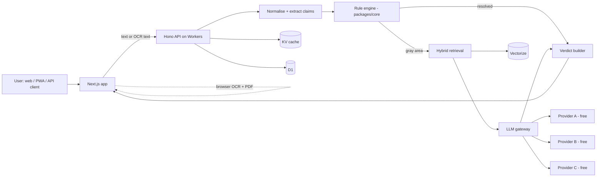

# Architecture

## 1. Design principles

1. **Rules first, LLM last.** Deterministic checks resolve what they can; the LLM only handles gray areas.
2. **Cite or abstain.** No verdict without a traceable rule or retrieved clause.
3. **Provider-agnostic.** No single AI vendor or free tier is a point of failure.
4. **Privacy by default.** Process locally where possible; do not store images.
5. **Pure core.** Business logic lives in `packages/core` with no I/O, so it is trivially testable.

## 2. System overview



## 3. Request lifecycle: `verify-claim`

1. **Validate** input (Zod), enforce rate limit and Turnstile token.
2. **Normalise** text (unicode, whitespace, language detect) and compute `claimHash`.
3. **Cache lookup** by `claimHash + ruleBaseVersion`. Hit returns immediately.
4. **Extract claims** (rules/regex first; LLM only if the text is unstructured or multi-claim).
5. **Run rules.** Each rule returns `pass | flag | n/a` with evidence.
6. **Decide path:**
   - All resolved → build verdict.
   - Unresolved → retrieve clauses, call LLM gateway with strict schema.
7. **Validate LLM output:** schema valid, every citation maps to a retrieved chunk ID, otherwise discard and abstain.
8. **Build verdict** (`CREDIBLE | VAGUE | LIKELY_MISLEADING | INSUFFICIENT_EVIDENCE`), risk score, explanation, "what would help".
9. **Persist** minimal record (claim text, verdict, versions), cache result, return.

## 4. Packages

### `packages/core`
Types (`Claim`, `Rule`, `RuleResult`, `Verdict`), rule runner, verdict aggregation, risk scoring. No network, no storage.

### `packages/llm-gateway`
- Single interface: `generateStructured({ schema, prompt, context })`.
- Provider adapters with timeouts and health tracking.
- Failover order configurable; circuit breaker per provider.
- Response cache keyed by prompt hash.
- Records provider + model id on every call for auditability.
- Never sends user-identifying data; sends claim text and retrieved clauses only.

### `packages/retrieval`
- Chunking of source texts with stable chunk IDs and source metadata (document, clause, version, URL).
- Hybrid search: keyword (BM25-style) + vector, merged by reciprocal rank fusion.
- Embedding provider behind an interface (free-tier friendly).

### `packages/sdk`
Typed client generated from the OpenAPI spec.

### `packages/eval`
Golden dataset loader, runner, metrics, regression report. See [EVALUATION.md](EVALUATION.md).

## 5. Apps

### `apps/web`
- Next.js App Router, TypeScript strict.
- Client-side: Tesseract.js OCR, barcode detection, `pdf-lib` complaint PDF.
- 3D (React Three Fiber) loaded dynamically on the results route only; 2D fallback for low-end devices or `prefers-reduced-motion`.
- i18n via next-intl (en, hi). PWA with service worker.

### `apps/api`
- Hono on Cloudflare Workers; routes defined with OpenAPI schemas.
- Bindings: D1, KV, Vectorize, R2 (optional), secrets for provider keys.

## 6. Data model (D1, initial)

```sql
claims(id, claim_hash, text, lang, created_at)
verdicts(id, claim_id, verdict, risk_score, rule_base_version,
         model_info, explanation_json, created_at)
rule_hits(id, verdict_id, rule_id, outcome, evidence)
citations(id, verdict_id, chunk_id, source_doc, clause_ref)
api_keys(id, key_hash, label, rate_limit, created_at, revoked_at)
```

Images are not persisted by default. Any opt-in sharing stores to R2 with expiry.

## 7. Configuration and secrets

`.env.example` lists variable names only. Keys are free-tier keys obtained from each provider. Never commit secrets; use Wrangler secrets in deployment.

```
LLM_PROVIDER_ORDER=providerA,providerB,providerC
PROVIDER_A_API_KEY=
PROVIDER_B_API_KEY=
TURNSTILE_SECRET=
```

## 8. Hosting and free-tier notes

- Cloudflare Pages/Workers is the target because its free tier permits commercial use; some other hosts' free plans are non-commercial only. Verify current terms before launch.
- Workers have CPU-time limits per request; LLM waiting is I/O, but keep CPU work (parsing, ranking) light and move heavy work to the browser.
- Free AI tiers can change limits or data-use terms. Treat them as best-effort and never send sensitive user data to them.

## 9. Observability

- Structured logs with request ID, no raw images.
- Error tracking (Sentry free tier), product analytics (privacy-respecting, opt-out).
- Metrics: rule-only resolution rate, LLM fallback rate, provider failure rate, abstention rate, cache hit rate.

## 10. CI/CD

- GitHub Actions: lint, typecheck, unit tests, Playwright smoke, **eval gate**.
- Preview deployments per PR.
- Dependency updates via Renovate/Dependabot.
- Conventional commits; changesets for package versioning.

## 11. Scaling path

If free-tier limits are outgrown: raise cache TTLs, batch embeddings offline, move OCR fully client-side, then consider paid tiers or self-hosted inference. No architecture change required thanks to the gateway and storage interfaces.
